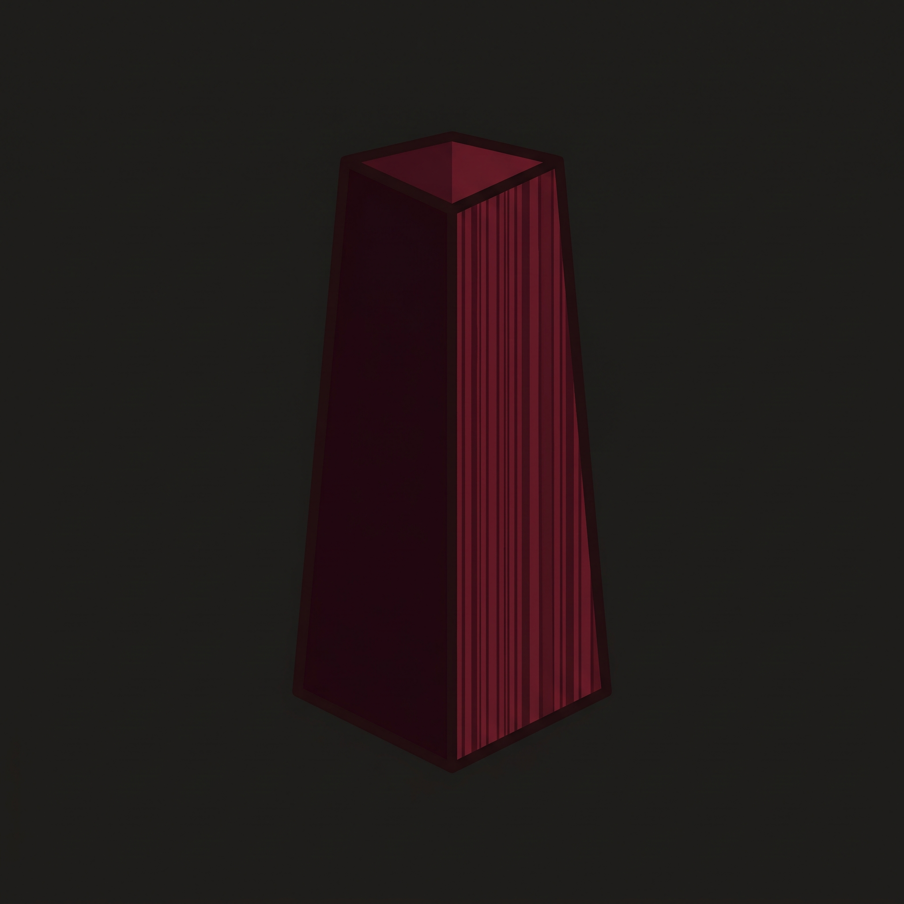
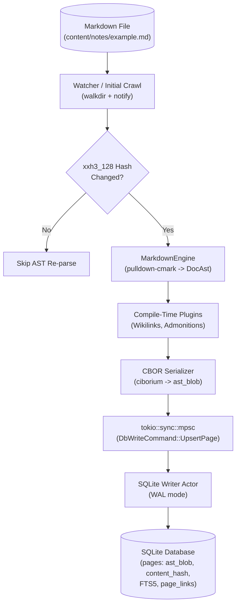
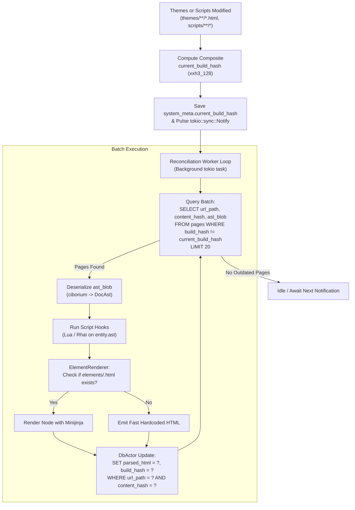
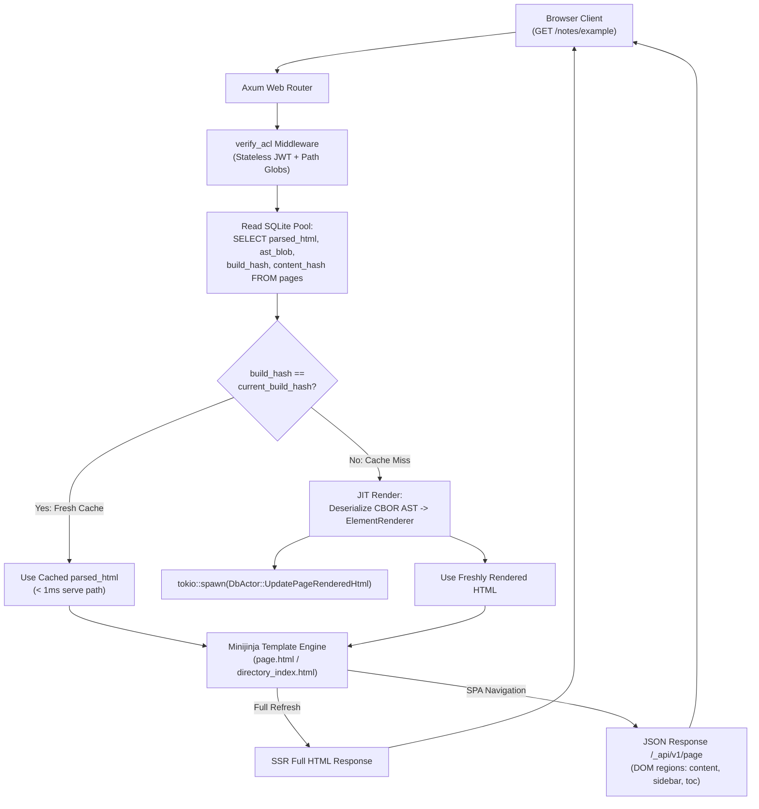

<p align="center">
  
</p>

<h1 align="center">Hematite 💎</h1>

<p align="center">
  <a href="#"></a>
  <a href="#"></a>
  <a href="LICENSE"></a>
</p>

<p align="center">
  <strong>A high-performance, single-binary Markdown CMS engine written in Rust.</strong>
</p>

---

**Hematite** is a high-performance, single-binary Markdown CMS engine written in Rust. It ingests folders of Markdown files (with native Obsidian dialect support) and serves them with **sub-millisecond server-side rendering (SSR)**, single-page application (SPA) region hydration, live filesystem synchronization, and stateless token-versioned ACL authentication.

Unlike traditional static site generators or flat Markdown-to-HTML servers, Hematite parses Markdown into a structured **Document Object Model (AST)** serialized into SQLite using binary CBOR. An asynchronous background reconciliation worker and JIT renderer dynamically transform that AST into HTML using optional per-element Minijinja templates (or high-speed Rust emitters) whenever themes or scripts change.

---

## 🌟 Key Highlights

- **⚡ Sub-Millisecond SSR**: HTML content is pre-rendered and cached in SQLite (WAL mode). Read requests bypass AST walks and template generation for instantaneous delivery.
- **🌳 Structured Document Object Model (DocAst)**: Content is parsed into a typed hierarchical AST and persisted as binary CBOR (`ciborium`), enabling rich structural inspection and transformation.
- **🎨 Granular Per-Element Theming**: Themes can override rendering for specific elements (e.g. `elements/admonition.html`, `elements/heading.html`). Un-overridden elements fall back to a zero-overhead compiled Rust emitter.
- **🔄 Invalidation & Background Reconciliation**: File watcher automatically tracks hashes of templates and scripts. Changes lazily trigger a batched background worker with Optimistic Concurrency Control (OCC) to prevent write races.
- **⚡ JIT Render on Cache Miss**: If a page is requested before the background worker updates it, Hematite renders the fresh HTML on the fly, serves it immediately, and updates the cache in the background.
- **🔗 Obsidian Native**: First-class support for `[[Wikilinks]]`, `[[Target|Alias]]`, `![[image.png]]` embeds, and collapsible callout admonitions (`> [!NOTE]`).
- **🗂️ Virtual Directory Hierarchy**: No need for `_index.md` in every folder; virtual directories and breadcrumb navigation trees are generated automatically from slug paths.
- **🛡️ Stateless JWT & Token Versioning**: Glob-based Access Control Lists (ACLs) evaluated in Axum middleware with instantaneous revocation via database token versioning.
- **🧩 Dual-Engine Extensibility Hooks**: Post-parse scripting in Lua (`.lua`) or Rhai (`.rhai`) with direct access to `entity.ast` and `config`.

---

## 🏗️ Architecture & Page Lifecycle

Hematite splits the document journey into three distinct, decoupled stages:

### Stage 1: Ingestion & Object Model Persistence
When files are added or modified, the crawler checks 128-bit xxHash diffs, parses Markdown into the typed `DocAst`, extracts internal links and search terms, serializes the AST into CBOR, and commits it to SQLite via a single-writer actor.



---

### Stage 2: Background Reconciliation & Element Rendering
When themes or scripts are modified, their composite build hash changes. A background worker queries outdated pages in small cooperative batches, executes Lua/Rhai hooks on the AST, renders elements through custom Minijinja templates (or fast Rust fallbacks), and saves the fresh HTML using Optimistic Concurrency Control (OCC).



---

### Stage 3: Request Pipeline & JIT Serve
When an HTTP client requests a URL, Axum checks the ACL permissions and queries SQLite. If the pre-rendered HTML matches the current build hash, it serves it in under a millisecond. If the cache is stale (a cache miss), it performs an on-the-fly JIT render from the CBOR AST, updates SQLite asynchronously, and renders the layout.



---

## 🚀 Quick Start

### 1. Running with Docker & Docker Compose (Recommended)

Hematite is published as a lightweight, unprivileged container image (`UID 33` / `www-data`) on GitHub Container Registry: `ghcr.io/apisarenco/hematite`.

You can use the sample compose setup provided in [`docker/docker-compose.yaml`](docker/docker-compose.yaml):

```yaml
services:
  hematite:
    image: ghcr.io/apisarenco/hematite:latest
    container_name: hematite
    # Use a uid:gid that has read access to all the mounted media
    user: "33:33"
    restart: unless-stopped
    ports:
      - "3000:3000"
    environment:
      - HEMATITE_CONTENT_DIR=/content
      - HEMATITE_THEMES_DIR=/app/themes
      - HEMATITE_SCRIPTS_DIR=/app/scripts
      - HEMATITE_CONFIG_PATH=/app/hematite.yaml
      - HEMATITE_DB_PATH=/data/hematite.db
      - HEMATITE_BIND_ADDR=0.0.0.0:3000
      - HEMATITE_JWT_SECRET=${HEMATITE_JWT_SECRET:-supersecretkey12345678901234567890}
    volumes:
      - hematite_data:/data
      - ./hematite.yaml:/app/hematite.yaml:ro
      - ./themes:/app/themes:ro
      - ./scripts:/app/scripts:ro
      - ./content:/content:ro

volumes:
  hematite_data:
```

Start the daemon in detached mode:
```bash
docker compose -f docker/docker-compose.yaml up -d
```

Or run directly with the Docker CLI:
```bash
docker run -d \
  --name hematite \
  --user 33:33 \
  -p 3000:3000 \
  -v $(pwd)/content:/content:ro \
  -v $(pwd)/hematite.yaml:/app/hematite.yaml:ro \
  -v $(pwd)/themes:/app/themes:ro \
  -v $(pwd)/scripts:/app/scripts:ro \
  -v hematite_data:/data \
  ghcr.io/apisarenco/hematite:latest
```

---

### 2. Building from Source (Local Native Run)
Hematite compiles into a single self-contained binary with zero dynamic runtime dependencies:

```bash
# Clone the repository
git clone https://github.com/apisarenco/hematite.git
cd hematite

# Run with defaults (creates ./content with sample files if empty)
cargo run --release
```

Or pass explicit directories:
```bash
cargo run --release -- \
  --content ./content \
  --themes ./themes \
  --scripts ./scripts \
  --config ./hematite.yaml \
  --bind 0.0.0.0:3000
```

---

### 3. Configuration (`hematite.yaml`)
Place a `hematite.yaml` at the root of your project:

```yaml
# Site Branding
name: "Aethelgard Wiki"
base_url: "https://wiki.example.com"
theme: "bemm"

# Arbitrary free-form variables accessible in templates & scripts:
campaign: "The Silver Crusade"
edition: "5e"
author: "Dungeon Master"
```

In any template or Lua/Rhai hook, access these with `config.campaign`, `config.author`, etc.

---

## 🎨 Per-Element Theming

Themes can selectively customize how individual AST nodes look without writing complex HTML parsers. Place templates inside `themes/<theme_name>/templates/elements/`:

| Element Template | Triggers For | Context Available |
| :--- | :--- | :--- |
| `elements/heading.html` | Headings (`<h1>` – `<h6>`) | `block.data.level`, `block.data.id`, `rendered_html`, `ast_title` |
| `elements/admonition.html` | Callouts (`> [!NOTE]`, etc.) | `block.data.kind`, `block.data.title`, `block.data.collapsible`, `rendered_html` |
| `elements/code_block.html` | Fenced & indented code | `block.data.language`, `block.data.code`, `rendered_html` |
| `elements/table.html` | Markdown tables | `block.data.headers`, `block.data.rows`, `rendered_html` |
| `elements/paragraph.html` | Paragraphs | `block.data.children`, `rendered_html` |
| `elements/blockquote.html` | Standard blockquotes | `block.data.children`, `rendered_html` |

#### Example: Custom Obsidian Callout (`themes/default/templates/elements/admonition.html`)
```html
<aside class="custom-callout callout-{{ block.data.kind }}">
  <div class="callout-header">
    <span class="icon">📢</span>
    <span class="title">{{ block.data.title or block.data.kind | capitalize }}</span>
  </div>
  <div class="callout-body">
    {{ rendered_html | safe }}
  </div>
</aside>
```
If an element template does not exist in the active theme, Hematite renders the element using its built-in, fast Rust emitter.

---

## 🧩 Extensibility Hooks (Lua & Rhai)

Place scripts in `scripts/hooks/file/` or `scripts/hooks/directory/` to transform page metadata or manipulate AST nodes during indexing:

- Executed in alphabetical order (e.g. `01_format_title.lua`, `02_verifier.rhai`).
- Direct access to `entity`, `context` (contains `all_pages`, `all_directories`), and `config`.

```lua
-- scripts/hooks/file/10_clean_title.lua
-- Strip numeric prefixes (e.g. "06_session") and capitalize each word
local function clean_title(str)
    str = str:gsub("^%s*%d+[%s_%.%-]*", "")
    str = str:gsub("_", " ")
    return str:gsub("(%a)([%w_']*)", function(first, rest)
        return first:upper() .. rest:lower()
    end)
end

if entity.title and entity.title ~= "" then
    entity.title = clean_title(entity.title)
end

return entity
```

---

## 🔒 Authentication & ACLs

- **Stateless JWT**: Passed via `Authorization: Bearer <token>` or `jwt` HTTP cookie.
- **Token Versioning**: User records track `token_version`. Bumping a user's version instantly invalidates outstanding tokens across the network without server-side session stores.
- **Admin Panel**: Visit `/_admin/` to manage users, roles, token versions, and glob-based path access control rules (e.g. `ALLOW /**`, `DENY /secret/*`). Default credentials on fresh install: `admin` / `admin123`.

---

## 🧪 Testing

Hematite features a test suite covering wikilinks, admonitions, AST CBOR roundtrips, element renderer overrides, background reconciliation loops, and ACL token invalidation:

```bash
cargo test
```

---

## 📄 License

This project is licensed under the [MIT License](LICENSE).
